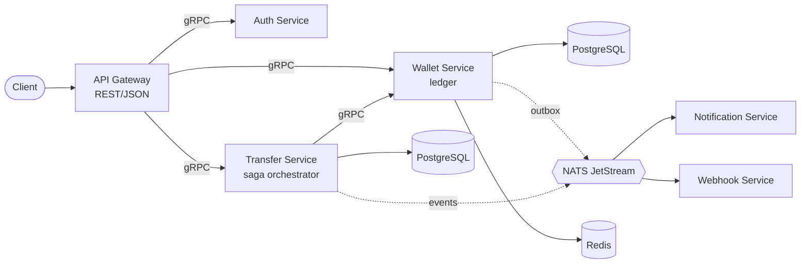

# Ledgerline

> A production-grade payments backend in Go: a double-entry ledger, six microservices, event-driven sagas, full observability, and deployment on Kubernetes.


Ledgerline is a learning project built from an empty folder up to a distributed payments system. The focus is correctness: money must never be created, lost, or double-spent, even under retries, crashes, and network faults.

## Highlights

- **Double-entry ledger** in PostgreSQL: append-only entries, derived balances, every transaction balanced
- **Safe money movement** using row locks, deadlock handling, retries with jitter, and **idempotency keys** (with a Redis fast path)
- **Type-safe SQL** with `sqlc` and `pgx` (connection pooling, atomic transactions)
- **Auth** with JWTs, Argon/bcrypt-style password hashing, and refresh token rotation
- **gRPC** between services behind a REST/JSON **API gateway** (CORS, limits, timeouts)
- **Events** over NATS JetStream with the **transactional outbox** pattern and a relay
- **Transfers as sagas**, with holds in the wallet and an orchestrator
- **Notifications** with retries and a **dead-letter queue**
- **Observability**: OpenTelemetry tracing across sync and async hops, Prometheus metrics, Grafana dashboards
- **Testing**: testcontainers, race detector, k6 load tests
- **Production extras**: signed webhooks (with SSRF protection), multi-currency FX, fraud/risk checks, reconciliation and CSV statements
- **Security**: mTLS, least-privilege database roles, audit log
- **Deployment**: distroless images, GitHub Actions CI, Docker Compose, Helm chart, autoscaling
- **Chaos engineering** to prove no money is ever lost

---

## Architecture



> Adjust this diagram to match your final service layout.

### Services

| Service | Responsibility |
|---|---|
| **api-gateway** | Single entry point; JSON to gRPC translation, CORS, limits, timeouts |
| **auth** | Registration, login, JWT issuance, refresh token rotation |
| **wallet** | Accounts, double-entry ledger, holds, deposits, idempotent money movement |
| **transfer** | Transfers as sagas, fraud screening, orchestration |
| **notification** | Event consumers, message senders, retries, dead-letter queue |
| **webhook / reporting** | Signed outbound webhooks, reconciliation, statements |

---

## Tech Stack

| Area | Tools |
|---|---|
| Language | Go |
| Database | PostgreSQL, `sqlc`, `pgx` |
| Cache | Redis |
| Messaging | NATS JetStream |
| RPC | gRPC, Protocol Buffers |
| Observability | OpenTelemetry, Prometheus, Grafana |
| Testing | testcontainers, Go race detector, k6 |
| Packaging / CI | Docker (multi-stage, distroless), GitHub Actions |
| Orchestration | Kubernetes, Helm |

---

## Getting Started

### Prerequisites

- Go 1.22+
- Docker and Docker Compose
- `sqlc`, `protoc` (with Go plugins), `make`
- For the later episodes: `kubectl`, `helm`, a local cluster (kind/minikube), `k6`

### Run locally

```bash
git clone https://github.com/<your-username>/ledgerline.git
cd ledgerline

# start Postgres, Redis, NATS, etc.
docker compose up -d

# run database migrations
make migrate-up

# run a service (example)
go run ./cmd/wallet
```

> Replace these commands with the real targets in your repo as you build them.

### Run the tests

```bash
go test ./... -race
```

Integration tests spin up their own Postgres and NATS containers via testcontainers, so Docker must be running.

---

## Project Structure

```text
.
├── cmd/                # service entrypoints (gateway, auth, wallet, transfer, ...)
├── internal/           # service logic, repositories, handlers
├── db/
│   ├── migrations/     # SQL migrations
│   └── queries/        # sqlc queries
├── proto/              # gRPC contracts
├── deploy/
│   ├── compose/        # Docker Compose setup
│   └── helm/           # Helm chart
├── loadtest/           # k6 scripts
└── docs/               # design notes
```

> Update this tree to match your actual layout.

## Design Principles

1. **Money is append-only.** Ledger entries are never updated or deleted; balances are derived.
2. **Every operation is idempotent.** Clients send an idempotency key; retries never double-spend.
3. **No dual writes.** State changes and events are committed together via the transactional outbox.
4. **Failures are expected.** Sagas compensate, consumers retry, poison messages go to a dead-letter queue.
5. **Least privilege everywhere.** Per-service database roles, mTLS between services.

## Acknowledgements

Built while following Fiston's course. All credit for the original design and teaching goes to the course author. Course ideas and chapters: https://www.fiston.dev/ideas

## License

MIT. See [LICENSE](LICENSE).